# 🚀 Spring Boot & Spring Cloud Microservices Labs

[](https://www.oracle.com/java/)
[](https://spring.io/projects/spring-boot)
[](https://spring.io/projects/spring-cloud)
[](https://www.rabbitmq.com/)
[](https://projectreactor.io/)
[](https://www.h2database.com/)
[](https://maven.apache.org/)

A comprehensive collection of 7 practical hands-on laboratories (**TP1 – TP7**) covering modern distributed enterprise architectures, microservices design patterns, inter-service communication, security, event-driven messaging, contract testing, and reactive programming with **Spring Boot** and **Spring Cloud**.

---

## 📑 Table of Contents

- [Overview & Architecture Matrix](#-overview--architecture-matrix)
- [Labs Summary](#-labs-summary)
  - [TP 1: Microservices Fundamentals & Synchronous REST Communication](#-tp-1-microservices-fundamentals--synchronous-rest-communication)
  - [TP 2: Autonomous Microservices & Database-per-Service with H2 & JPA](#-tp-2-autonomous-microservices--database-per-service-with-h2--jpa)
  - [TP 3: Service Discovery & Registration with Spring Cloud Netflix Eureka](#-tp-3-service-discovery--registration-with-spring-cloud-netflix-eureka)
  - [TP 4: Securing Microservices with Spring Security & Stateless JWT](#-tp-4-securing-microservices-with-spring-security--stateless-jwt)
  - [TP 5: Asynchronous Event-Driven Messaging with RabbitMQ](#-tp-5-asynchronous-event-driven-messaging-with-rabbitmq)
  - [TP 6: Consumer-Driven Contract Testing with Spring Cloud Contract](#-tp-6-consumer-driven-contract-testing-with-spring-cloud-contract)
  - [TP 7: Reactive Microservices with Spring WebFlux & Project Reactor](#-tp-7-reactive-microservices-with-spring-webflux--project-reactor)
- [Project Directory Structure](#-project-directory-structure)
- [Prerequisites & Environment Setup](#-prerequisites--environment-setup)
- [How to Run the Microservices](#-how-to-run-the-microservices)
- [Author](#-author)

---

## 🏛 Overview & Architecture Matrix

This repository illustrates the progressive evolution of a microservice-based system, addressing fundamental architectural challenges:

```mermaid
flowchart TD
    subgraph Discovery ["Service Discovery (TP3)"]
        Eureka["Eureka Server (:8761)"]
    end

    subgraph Security ["Security & Identity (TP4)"]
        AuthService["Auth Service (:8081)\n(JWT Token Provider)"]
    end

    subgraph SyncCommunication ["Synchronous REST & JPA (TP1, TP2)"]
        OrderServiceSync["Order Service (:8083)\n(H2 orderdb)"]
        CustomerServiceSync["Customer Service (:8082)\n(H2 customerdb)"]
        ProductServiceSync["Product Service (:8080)"]
        OrderServiceSync -->|"RestTemplate HTTP"| CustomerServiceSync
        OrderServiceSync -->|"RestTemplate HTTP"| ProductServiceSync
    end

    subgraph Messaging ["Event-Driven Messaging (TP5)"]
        CustomerServiceAsync["Customer Service (:8082)\n(Producer)"]
        RabbitBroker["RabbitMQ Broker (:5672)\nExchange: order_exchange"]
        OrderServiceAsync["Order Service (:8083)\n(Consumer)"]
        CustomerServiceAsync -->|"Publish OrderDto"| RabbitBroker
        RabbitBroker -->|"order_queue"| OrderServiceAsync
    end

    subgraph ContractTesting ["Contract-Driven Testing (TP6)"]
        ProducerContract["Customer Service (:8082)\n(Groovy DSL Contract)"]
        ConsumerContract["Order Service\n(Stub Runner :8085)"]
        ProducerContract -.->|"Generates Stubs JAR"| ConsumerContract
    end

    subgraph ReactiveStack ["Reactive Non-Blocking Stack (TP7)"]
        StudentServiceReactive["Student Service (:8081)\n(Reactive WebClient)"]
        CourseServiceReactive["Course Service (:8082)\n(Mono / Flux Stream)"]
        StudentServiceReactive -->|"Non-blocking HTTP"| CourseServiceReactive
    end

    CustomerServiceSync -.->|"Heartbeat / Register"| Eureka
    OrderServiceSync -.->|"Heartbeat / Register"| Eureka
```



| Lab | Subject / Theme | Microservices Involved | Default Ports | Key Patterns & Technologies |
| :--- | :--- | :--- | :--- | :--- |
| **TP 1** | Microservices Fundamentals | `microservice-product`, `microservice-order` | `8080`, `8081` | REST Controllers, `RestTemplate`, Synchronous HTTP |
| **TP 2** | Autonomous Services & DBs | `microservice-customer`, `microservice-order` | `8082`, `8083` | Database-per-Service, Spring Data JPA, H2 In-Memory DB, Eureka Client |
| **TP 3** | Service Registry & Discovery | `discovery-server` | `8761` | Netflix Eureka Server, `@EnableEurekaServer`, Dynamic Discovery |
| **TP 4** | Microservices Security & JWT | `auth-service` | `8081` | Spring Security 6, JWT (io.jsonwebtoken), Stateless Auth, HMAC-SHA256 |
| **TP 5** | Asynchronous Messaging | `Customer-service`, `Order-service` | `8082`, `8083` | RabbitMQ / AMQP, Direct Exchange, Queues, Routing Keys, Jackson2Json |
| **TP 6** | Consumer-Driven Contracts | `Customer-service`, `order-service` | `8080`, `8085 (Stub)` | Spring Cloud Contract, Groovy Contract DSL, WireMock, Stub Runner |
| **TP 7** | Reactive Microservices | `Course-service`, `Student-service` | `8082`, `8081` | Spring WebFlux, Project Reactor (`Mono`, `Flux`), Non-blocking `WebClient` |

---

## 🔬 Labs Summary

### 📦 TP 1: Microservices Fundamentals & Synchronous REST Communication

- **Objective**: Create independent microservices and establish synchronous point-to-point HTTP communication.
- **Projects**:
  - `microservice-product`: Manages a catalog of products (`id`, `name`).
  - `microservice-order`: Exposes order management and aggregates product data by querying the product service via `RestTemplate`.
- **Key Endpoints**:
  - `GET http://localhost:8080/products`: Returns list of available products.
  - `GET http://localhost:8080/products/{id}`: Returns specific product details.
  - `GET http://localhost:8081/orders/with-products`: Fetches product information synchronously and returns an aggregated order summary.

---

### 🗄 TP 2: Autonomous Microservices & Database-per-Service with H2 & JPA

- **Objective**: Implement the **Database-per-Service** design pattern ensuring complete loose coupling between data stores.
- **Projects**:
  - `microservice-customer` (Port `8082`): Manages customer entities (`id`, `name`, `email`) using Spring Data JPA and an isolated H2 in-memory database (`jdbc:h2:mem:customerdb`).
  - `microservice-order` (Port `8083`): Manages order entities (`id`, `customerId`, `orderDate`, `amount`) stored in its own H2 database (`jdbc:h2:mem:order-db`).
- **Key Endpoints & Features**:
  - `GET http://localhost:8082/customers`: Retrieve all customers.
  - `GET http://localhost:8083/orders/with-customer/{id}`: Composes order data with customer profile fetched via `RestTemplate`.
  - H2 Web Console: Accessible at `http://localhost:8082/h2-console` and `http://localhost:8083/h2-console`.

---

### 🌐 TP 3: Service Discovery & Registration with Spring Cloud Netflix Eureka

- **Objective**: Eliminate hardcoded service hostnames and ports through centralized dynamic service registration and discovery.
- **Projects**:
  - `discovery-server` (Port `8761`): Eureka Service Registry.
- **Key Features**:
  - Configured with `@EnableEurekaServer`.
  - Disables self-registration (`register-with-eureka: false`, `fetch-registry: false`).
  - Client microservices (e.g., from TP2) register their heartbeat and network metadata via:
    ```yaml
    eureka:
      client:
        service-url:
          defaultZone: http://localhost:8761/eureka/
    ```
  - **Eureka Dashboard**: Inspect active service instances in real time at `http://localhost:8761`.

---

### 🔐 TP 4: Securing Microservices with Spring Security & Stateless JWT

- **Objective**: Secure distributed microservices using stateless token-based authentication with **JSON Web Tokens (JWT)**.
- **Projects**:
  - `auth-service` (Port `8081`): Authentication and token generation service.
- **Key Features**:
  - `JwtService`: Encapsulates HMAC-SHA256 signing, claims extraction, subject storage, and expiration checks.
  - `SecurityConfig`: Configures Spring Security filter chains, disables CSRF, and enforces stateless session management (`SessionCreationPolicy.STATELESS`).
- **Authentication Flow**:
  ```bash
  curl -X POST http://localhost:8081/auth/login \
       -H "Content-Type: application/json" \
       -d '{"username": "admin", "password": "1234"}'
  ```
  Returns a cryptographically signed JWT token ready for Bearer authentication headers.

---

### 🐇 TP 5: Asynchronous Event-Driven Messaging with RabbitMQ

- **Objective**: Decouple microservices and improve resilience and throughput through asynchronous message passing using an AMQP message broker (**RabbitMQ**).
- **Projects**:
  - `Customer-service` (Port `8082` - Producer): Emits order events (`OrderDto`) using Spring AMQP `RabbitTemplate`.
  - `Order-service` (Port `8083` - Consumer): Asynchronously listens to incoming messages using `@RabbitListener`.
- **AMQP Topology**:
  - **Exchange**: `order_exchange` (Direct Exchange)
  - **Queue**: `order_queue`
  - **Routing Key**: `order_routing_key`
  - **Message Converter**: `Jackson2JsonMessageConverter` for seamless JSON payload serialization/deserialization.
- **Workflow**:
  ```bash
  curl -X POST http://localhost:8082/customers/orders \
       -H "Content-Type: application/json" \
       -d '{"orderId": 101, "customerId": 5, "productName": "Laptop Dell XPS"}'
  ```
  The order is published to the exchange and consumed asynchronously by `OrderListener` in the order service without blocking the caller.

---

### 📜 TP 6: Consumer-Driven Contract Testing with Spring Cloud Contract

- **Objective**: Guarantee API backward compatibility and seamless integration between microservices without spinning up full end-to-end environments.
- **Projects**:
  - `Customer-service` (Producer): Defines the contract specification in Groovy DSL (`get_customer_by_id.groovy`) and provides `BaseClass` with `RestAssuredMockMvc`.
  - `order-service` (Consumer): Uses `CustomerClient` to invoke customer APIs and verifies consumer logic against generated stubs using `@AutoConfigureStubRunner`.
- **Contract Specification (`get_customer_by_id.groovy`)**:
  ```groovy
  package contracts

  org.springframework.cloud.contract.spec.Contract.make {
      description "returns customer by id"
      request {
          method GET()
          urlPath("/customers/1")
      }
      response {
          status 200
          headers {
              contentType(applicationJson())
          }
          body([
              id: "1",
              name: "Nom",
              country: "Pays"
          ])
      }
  }
  ```
- **Verification Workflow**:
  1. Producer generates stubs and validates contract via `mvn clean test`.
  2. Consumer runs unit tests against an in-memory WireMock stub server (`AutoConfigureStubRunner`).

---

### ⚡ TP 7: Reactive Microservices with Spring WebFlux & Project Reactor

- **Objective**: Build non-blocking, event-driven reactive microservices capable of handling high concurrency with minimal resource consumption.
- **Projects**:
  - `Course-service` (Port `8082`): Reactive producer exposing non-blocking endpoints returning `Mono<Course>` and `Flux<Course>`.
  - `Student-service` (Port `8081`): Reactive consumer using non-blocking `WebClient` to fetch courses and aggregate student records asynchronously via `Flux.flatMap`.
- **Key Concepts**:
  - Non-blocking I/O based on the Netty runtime.
  - Reactive Streams specifications with Project Reactor publishers:
    - `Mono<T>`: 0 or 1 item publisher.
    - `Flux<T>`: 0 to N items publisher.
  - Non-blocking `WebClient` composition:
    ```java
    @GetMapping
    public Flux<StudentResponse> getAllStudents() {
        return Flux.fromIterable(students)
                .flatMap(s -> webClient.get()
                        .uri("/courses/" + s.getCourseId())
                        .retrieve()
                        .bodyToMono(Course.class)
                        .map(c -> new StudentResponse(s.getId(), s.getName(), c))
                );
    }
    ```
- **Key Endpoints**:
  - `GET http://localhost:8082/courses`: Stream of courses.
  - `GET http://localhost:8082/courses/{id}`: Single course mono.
  - `GET http://localhost:8081/students`: Asynchronously aggregated student-course profiles.

---

## 📂 Project Directory Structure

```text
Springboot Labs/
├── TP1/
│   ├── microservice-order/          # Order service (RestTemplate caller)
│   ├── microservice-product/        # Product catalog service
│   └── TP1 Création des microservices.pdf
├── TP2/
│   ├── microservice-customer/       # Customer service with H2 Database & JPA
│   ├── microservice-order/          # Order service with H2 Database & Eureka Client
│   └── TP2 Developpement de microservices autonomes et interconnectes...pdf
├── TP3/
│   ├── discovery-server/            # Spring Cloud Netflix Eureka Discovery Server
│   └── TP3-API-Gateway-et-Service-Discovery-avec-Spring-Cloud.pdf
├── TP4/
│   ├── auth-service/                # Spring Security & JWT Authentication Service
│   └── TP4-Sécurisation-des-microservices-avec-Spring-Security-et-JWT.pdf
├── TP5/
│   ├── Customer-service/            # RabbitMQ Message Producer
│   ├── Order-service/               # RabbitMQ Message Consumer
│   └── TP5 Communication asynchrone entre les microservices avec rabbitmq.pdf
├── TP6/
│   ├── Customer-service/            # Producer with Spring Cloud Contract & Stubs
│   ├── order-service/               # Consumer with Stub Runner integration tests
│   └── TP6 spring.pdf
├── TP7/
│   ├── Course-service/              # Reactive Spring WebFlux Course API
│   ├── Student-service/             # Reactive WebClient Student aggregator
│   └── TP7 developpement de microservice reactifs avec spring webflux.pdf
├── .gitignore                       # Clean Git ignore rules (builds, target, IDE files)
└── README.md                        # Documentation
```

---

## 🛠 Prerequisites & Environment Setup

Ensure the following tools are installed on your machine:

- **JDK 17 or JDK 21**:
  ```bash
  java -version
  ```
- **Apache Maven 3.8+**:
  ```bash
  mvn -version
  ```
- **Docker** (recommended for RabbitMQ in TP5):
  ```bash
  # Spin up RabbitMQ with Management UI in one command
  docker run -d --name rabbitmq \
    -p 5672:5672 \
    -p 15672:15672 \
    rabbitmq:3-management
  ```
  RabbitMQ Management console will be accessible at: `http://localhost:15672` (default credentials: `guest` / `guest`).

---

## 🏃 How to Run the Microservices

You can run any microservice either through your favorite IDE (IntelliJ IDEA, Eclipse, VS Code) or via command line using the Maven wrapper or Maven CLI:

```bash
# Navigate to the microservice directory
cd "TP5/Customer-service/Customer-service"

# Build and run with Maven
mvn spring-boot:run
```

For **TP6 (Contract Testing)**:
```bash
# 1. In Customer-service (Producer): build stubs and install in local repo
cd "TP6/Customer-service"
mvn clean install -DskipTests

# 2. In order-service (Consumer): run tests with Stub Runner
cd "../order-service"
mvn clean test
```

---

## 👤 Author

- **Fedy Zarai** ([@fadizarai](https://github.com/fadizarai))
- Engineering Curriculum — Advanced Development / Microservices Architecture
